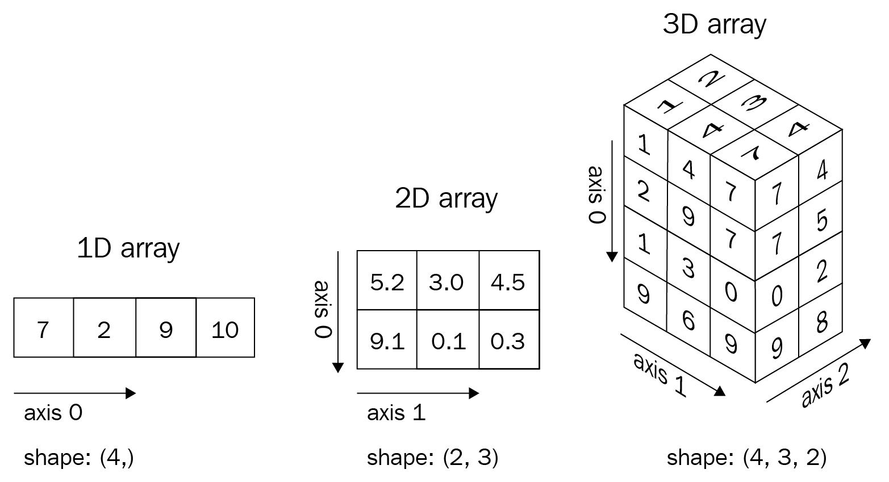
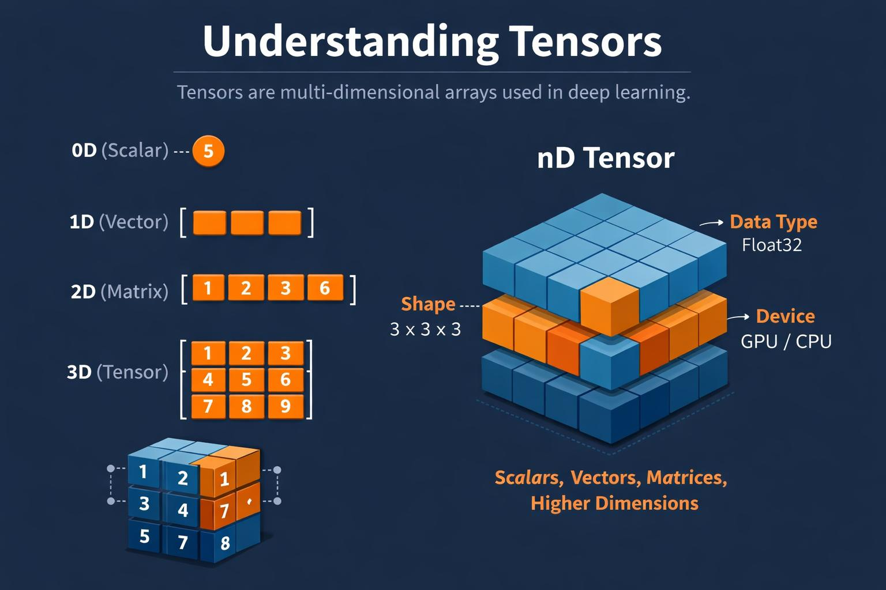
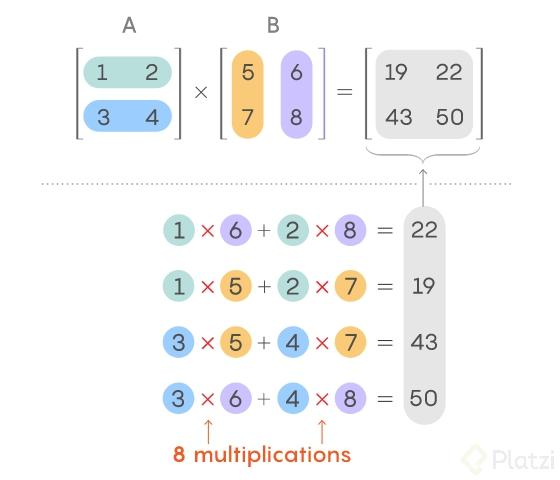

# NumPy for Data Science, Machine Learning, and Deep Learning

This module introduces NumPy as the numerical foundation for Python data science. It is centered on the hands-on notebook [01_NumPy_for_ML_DL.ipynb](notebooks/01_NumPy_for_ML_DL.ipynb), with examples that progress from array fundamentals to practical machine-learning and computer-vision workflows.

> **Module scope:** This README documents the NumPy section only. Pandas, Matplotlib, Seaborn, and other EDA/visualization tools belong to their own modules.

## Learning outcomes

After working through the notebook, you should be able to:

- Explain what a NumPy `ndarray` is and why it is useful for numerical work.
- Create, inspect, index, slice, filter, reshape, and combine arrays.
- Reason about dimensions, shapes, axes, broadcasting, and result shapes.
- Apply vectorized calculations, aggregations, sorting, and random sampling.
- Use NumPy arrays for feature scaling, simple predictions, gradient descent, image batches, and image crops.

## Getting started

### Requirements

- Python 3
- Jupyter Notebook or JupyterLab
- NumPy

Install NumPy in the environment used by your notebook:

```bash
python -m pip install numpy
```

In a notebook cell, you can instead run:

```python
%pip install numpy
```

Import NumPy using the conventional alias:

```python
import numpy as np
```

Open [`notebooks/01_NumPy_for_ML_DL.ipynb`](notebooks/01_NumPy_for_ML_DL.ipynb) and run the cells in order. For each example, predict the result and shape before executing it.

## Notebook topics

The notebook covers the following topics, in sequence:

1. **Why NumPy?** Compare Python lists with homogeneous numerical arrays and introduce vectorized, element-wise calculations.
2. **Array creation** Build arrays with `np.array`, `np.zeros`, `np.ones`, `np.full`, `np.arange`, `np.linspace`, and `np.eye`; compare step-based and sample-count-based sequences.
3. **Array attributes** Inspect `ndim`, `shape`, `size`, and `dtype`; interpret axis sizes and total element counts.
4. **Dimensions and tensors** Understand 1D, 2D, 3D, and 4D arrays through sensor data, student marks, and image batches; discuss NHWC and NCHW layouts.
5. **Indexing** Access elements, rows, columns, and positions in 1D through 4D arrays.
6. **Slicing** Select ranges, submatrices, and image channels using start/stop/step notation.
7. **Views and copies** See how a basic slice can share storage with its source and when `.copy()` is needed.
8. **Boolean indexing and filtering** Build masks, select values, find matching indices, and modify values that meet a condition.
9. **Fancy indexing** Select chosen positions or rows with integer-array indices.
10. **Reshaping** Reorganize arrays while preserving element count, infer a dimension with `-1`, and create batch/column dimensions.
11. **Transpose and axis swapping** Use `.T`, `np.transpose`, and axis permutations to change array layout.
12. **Joining and splitting** Work with `np.concatenate`, `np.vstack`, `np.hstack`, `np.stack`, `np.split`, and `np.array_split`.
13. **Vectorized arithmetic and universal functions** Apply element-wise operators, comparisons, and functions such as `sqrt`, `exp`, `log`, and `abs`; distinguish `*` from `@`.
14. **Broadcasting** Apply scalars, per-row offsets, and per-feature offsets to compatible shapes.
15. **Aggregations and axes** Calculate sums, means, extrema, standard deviations, variances, and argmin/argmax results across arrays and selected axes.
16. **Sorting and value counts** Use `sort`, `argsort`, `unique`, `return_counts`, and `clip`.
17. **Missing values and data types** Work with `np.nan`, `np.isnan`, `np.nanmean`, and dtype conversion with `.astype()`.
18. **Random sampling** Use `np.random.default_rng` for reproducible integer, uniform, normal, and permutation samples.
19. **Linear algebra** Calculate dot products and matrix products; understand feature/weight shapes and `@`.
20. **ML example — feature scaling** Use column-wise minima/maxima and broadcasting for min-max scaling.
21. **ML example — linear predictions and MAE** Compute predictions with `X @ w + b` and calculate mean absolute error.
22. **ML example — gradient descent** Update the weight and bias of a toy linear model with NumPy gradients.
23. **DL example — image tensors** Create, normalize, and select mini-batches and channels from RGB image tensors.
24. **Computer-vision example — image regions** Represent a grayscale image as an array and crop a rectangular region.
25. **Debugging checklist** Review common pitfalls involving indices, reshape sizes, broadcasting, views, axes, dtypes, NaNs, and image layout.
26. **Practice exercises and solutions** Apply array operations, filtering, reshaping, broadcasting, scaling, tensors, and predictions.
27. **Quick reference and official documentation** Review frequently used expressions and continue with NumPy's user and API guides.

## Core concepts

### Arrays and shapes

A NumPy array stores values in an N-dimensional structure. Its shape describes the length of each axis:

```python
data = np.array([[10, 20, 30],
                 [40, 50, 60]])

data.ndim   # 2 axes
data.shape  # (2, 3): 2 rows, 3 columns
data.size   # 6 elements
data.dtype  # element data type
```

Typical interpretations include a 1D feature vector `(features,)`, a 2D data matrix `(samples, features)`, or an image batch `(batch, height, width, channels)`. The axis meanings are determined by the application, so document them and check shapes as you work.

### Indexing and slicing

NumPy indices start at zero. For a 2D array, use `array[row, column]`; a colon selects a range along an axis:

```python
data[0, 1]   # first row, second column
data[:, 1]   # second column
data[0, :2]  # first two elements of the first row
```

Basic slicing commonly returns a view, so modifying it may modify the original array. Use `array_slice.copy()` when an independent copy is required. Boolean masks and integer-array indexing are useful for filtering and selecting specific records.

### Broadcasting and axes

Broadcasting allows compatible shapes to work together without explicitly repeating values. Compare dimensions from right to left: each pair must be equal or one of them must be `1`.

```python
features = np.array([[10, 20, 30],
                     [40, 50, 60]])
offsets = np.array([1, 2, 3])
features + offsets  # offsets are applied to each row
```

For a 2D array, `axis=0` reduces down the rows and returns one value per column; `axis=1` reduces across columns and returns one value per row. Always connect the axis number to what that axis represents in your data.

### Machine-learning calculations

For a feature matrix `X` with shape `(samples, features)` and weights `w` with shape `(features,)`, `X @ w` produces one value per sample. Broadcasting can then apply a scalar bias:

```python
predictions = X @ w + b
```

The notebook builds on these operations for feature scaling, error metrics, gradient updates, and image preprocessing. These examples teach array mechanics; production ML pipelines must also handle data leakage, constant-valued features, model-specific preprocessing, and correct image layouts.

## Reference images

The following illustrations are stored in [`Images/`](Images/):

### Array dimensions




### Tensors and operations





## Common NumPy pitfalls

- A reshape must preserve the total number of elements.
- Broadcasting compatibility is determined from the trailing dimensions.
- `*` performs element-wise multiplication; `@` performs matrix multiplication.
- Basic slices may be views; copy explicitly before independent mutation.
- Choose an aggregation axis based on the data meaning, not by guesswork.
- Confirm whether an image pipeline expects NHWC or NCHW layout.
- Integer arrays cannot directly represent `np.nan`; use a suitable floating dtype.
- Ordinary reductions such as `np.mean` propagate NaNs; use a NaN-aware reduction when appropriate.
- Inspect `shape`, `ndim`, and `dtype` when debugging an unexpected result.

## Quick reference

| Task | Example |
|---|---|
| Create an array | `np.array([1, 2, 3])` |
| Initialize values | `np.zeros((2, 3))`, `np.ones((2, 3))` |
| Inspect an array | `a.ndim`, `a.shape`, `a.size`, `a.dtype` |
| Reshape | `a.reshape(2, 3)` |
| Select values | `a[0]`, `matrix[1, 2]`, `matrix[:, 1]` |
| Filter by condition | `a[a > 0]` |
| Find matching indices | `np.where(a > 0)` |
| Aggregate | `a.sum()`, `matrix.mean(axis=0)` |
| Sort and count | `np.sort(a)`, `np.unique(a, return_counts=True)` |
| Combine arrays | `np.concatenate([a, b], axis=0)` |
| Add a dimension | `a[np.newaxis, :]`, `np.expand_dims(a, axis=0)` |
| Transpose | `a.T`, `np.transpose(a, axes=...)` |
| Matrix multiplication | `A @ B`, `np.matmul(A, B)` |
| Reproducible randomness | `rng = np.random.default_rng(42)` |
| Ignore NaNs in a mean | `np.nanmean(a)` |
| Limit values to a range | `np.clip(a, low, high)` |

## Further reading

- [NumPy absolute basics for beginners](https://numpy.org/doc/stable/user/absolute_beginners.html)
- [NumPy user guide](https://numpy.org/doc/stable/user/index.html)
- [Indexing on ndarrays](https://numpy.org/doc/stable/user/basics.indexing.html)
- [Broadcasting](https://numpy.org/doc/stable/user/basics.broadcasting.html)
- [Array manipulation routines](https://numpy.org/doc/stable/reference/routines.array-manipulation.html)
- [Mathematical functions](https://numpy.org/doc/stable/reference/routines.math.html)
- [Linear algebra](https://numpy.org/doc/stable/reference/routines.linalg.html)
- [Random sampling](https://numpy.org/doc/stable/reference/random/index.html)
- [NumPy API reference](https://numpy.org/doc/stable/reference/)

The most useful debugging habit from this module is to ask three questions before each operation: **What does each axis mean? What is the current shape? What shape should the result have?**
